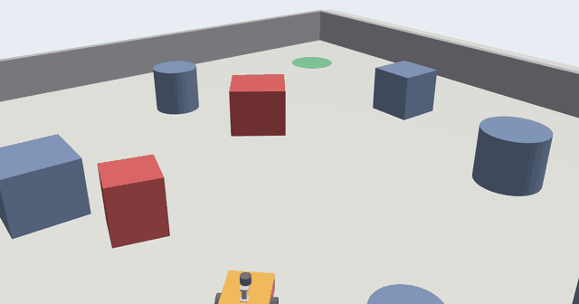
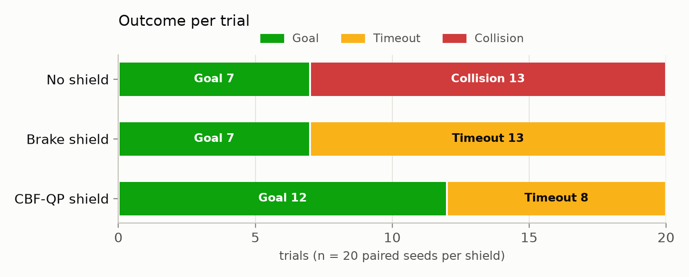
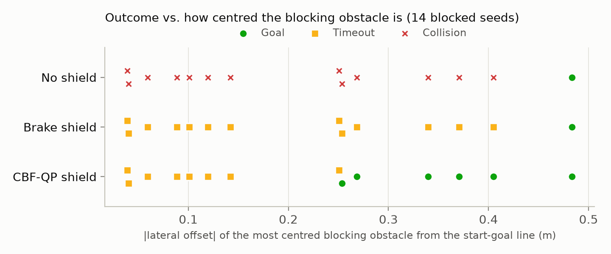
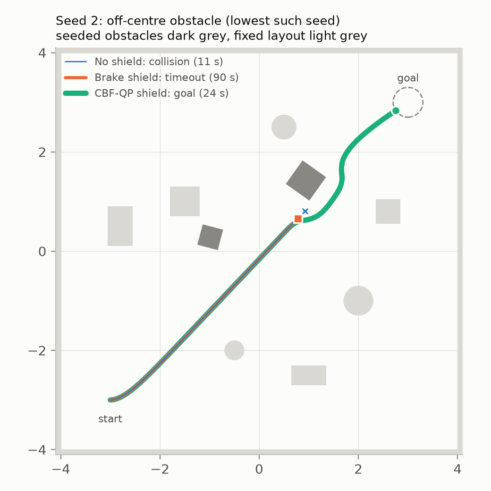
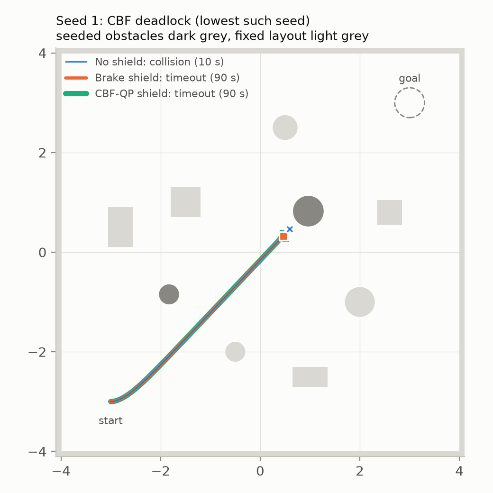
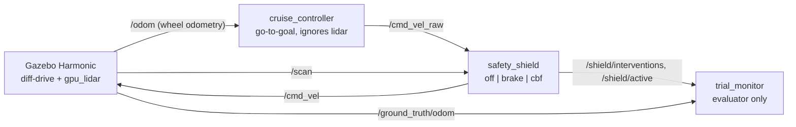

# PlanGuard-ROS2

[](https://github.com/Peoplerepabulic/planguard-ros2/actions/workflows/ci.yml)
[](https://codespaces.new/Peoplerepabulic/planguard-ros2)

**Runtime safety shields for an unreliable controller, in ROS 2 Jazzy (C++) and Gazebo Harmonic.**

A deliberately unreliable go-to-goal controller drives a differential-drive robot straight at its goal and never looks at the lidar. A safety shield sits between that controller and the wheels, and it is the only thing that can prevent a crash. I compare three conditions on the same 20 randomized worlds: no shield, a stop/slow-down **brake shield** (the usual industrial baseline), and a **CBF-QP shield** (control barrier function + quadratic program). The question is what each shield guarantees and what it costs in task completion.

This is the execution layer of PlanGuard. The original PlanGuard checks LLM-generated robot task plans before they run. This repo covers the next layer down: once a plan is executing, a component that does not trust its proposer filters every motor command.



## Results

20 paired seeds × 3 shields = 60 headless Gazebo trials, with every trial reported ([raw CSV](results/main_trials.csv), [full summary](results/main_summary.md)).

| Shield | Collisions (95% Wilson CI) | Reached goal (95% CI) | Timeouts | Worst min. clearance |
|---|---|---|---|---|
| No shield | 13/20 (0.43–0.82) | 7/20 (0.18–0.57) | 0/20 | 0.000 m |
| Brake shield | **0/20** (0.00–0.16) | 7/20 (0.18–0.57) | 13/20 | 0.052 m |
| CBF-QP shield | **0/20** (0.00–0.16) | **12/20** (0.39–0.78) | 8/20 | 0.072 m |



What the data shows:

1. **Both shields remove every collision.** Collisions drop from 13/20 to 0/20 under each shield (exact McNemar test on the paired seeds, p = 0.0002 in both cases).
2. **The brake shield turns collisions into deadlocks.** It stops in front of the obstacle, and the controller has no idea why it cannot move. As a result it reaches the goal on exactly the seeds where the unshielded robot already did (7/20).
3. **The CBF shield keeps the robot moving.** It changes both $v$ and $\omega$, so the robot slides around obstacles. It reached the goal on 12/20 seeds. On every seed where the CBF and brake shields disagree, the CBF wins (5–0). With n = 20 that gives p = 0.0625: the direction is consistent but not significant at 0.05.
4. **CBF failures follow a clear pattern.** The CBF timed out on all 7 seeds whose blocking obstacle sits within 0.15 m of the straight start–goal line, and it reached the goal on 6 of the 7 seeds where that offset is 0.25 m or more. The one exception, seed 12, has a 0.64 m box that the robot still meets almost head-on. This is the undesirable equilibrium that CBF-QPs are known to introduce ([Reis et al. 2021](https://arxiv.org/abs/2006.04848)). When the nominal command points straight into the obstacle, the projection has no reason to prefer left over right, so the filter only brakes. A unit test (`Cbf.SymmetricHeadOnObstacleGivesNoTurn`) pins this behaviour down.
5. **The brake shield's guarantee covers less than it appears to.** It only watches a forward corridor, so turning in place can swing the footprint toward a side obstacle (worst clearance 0.052 m, seed 12). The CBF's rear circle covers that case by construction.
6. **Efficiency cost when the path is clear is negligible.** On the 7 seeds where all three conditions reach the goal, the CBF is slower by a median of 0.14 s.



| CBF passes (seed 2, lowest such seed) | CBF deadlock (seed 1, lowest such seed) |
|---|---|
|  |  |

## System



| Package | Contents |
|---|---|
| `planguard_control` (C++) | `planguard_core` library (ROS-free: cruise law, brake filter, exact 2-D QP, CBF filter), `cruise_controller` and `safety_shield` nodes, 23 gtest cases |
| `planguard_description` | xacro robot (custom chassis + L-bracket meshes), Gazebo worlds, launch file, `ros_gz` bridge config |
| `scripts/` | `worldgen.py` (seeded worlds), `run_trials.py` (batch runner), `trial_monitor.py` (evaluator), `summarize.py` (stats + figures) |
| `cad/` | parametric CadQuery source + STEP files for the chassis and lidar bracket (STEP opens in Fusion 360) |

## Design decisions

- **The proposer is unreliable on purpose.** `cruise_controller` turns toward the goal, drives, slows near the goal, and stops within 0.30 m. It reads wheel odometry only. Avoiding obstacles is not its job, so whatever safety the system has comes from the shield.
- **The shield is always in the loop.** In `off` mode it passes commands through unchanged, so all three conditions have identical topology, latency and QoS. The only variable is the filter.
- **Fail-safe.** In `brake` and `cbf` modes, a scan that is missing or older than 0.5 s of simulation time produces a zero command.
- **Distances are measured from the collision footprint, not from the lidar.** The lidar sits at the robot centre, so "0.35 m from the lidar" would really mean 0.15 m from the bumper. The brake shield instead uses a forward corridor as wide as the footprint plus 5 cm. A ±30° sector would miss a point 4 cm ahead of the bumper and 0.14 m to the side (30.3°); a unit test covers exactly that case.
- **The evaluator does not share the shield's sensor.** Collisions are judged from the ground-truth pose and the exact obstacle geometry written by `worldgen.py`: footprint-to-obstacle clearance ≤ 1 cm counts as a collision. Using the lidar would be circular. The outcome rules are stated at the top of `trial_monitor.py`.
- **Simulation time everywhere.** Every node uses `use_sim_time`, the control loop runs on a node-clock timer (not a wall timer), and the 90 s limit is counted in simulation time. Headless RTF on the 2-core test machine was about 0.9, so wall-clock timing would not be reproducible.
- **Paired design.** Every seed fixes one world and is run under all three shields in interleaved order, and every trial is appended to the CSV as soon as it finishes. That is why the tests are McNemar (paired binary outcomes) and Wilcoxon signed-rank (paired continuous outcomes) rather than unpaired comparisons.
- **Exact odometry.** Wheel collisions are spheres. A 4 cm collision cylinder touches the ground at both rims and scrubs when turning, which in testing gave about 4° of heading error per 45° turn and 0.5 m of drift over the run. The cost is a wider collision footprint (half-width 0.23 m), and both the shields and the evaluator use that footprint.

## The CBF-QP shield

The collision footprint is covered by two circles on the robot's x-axis, at $c_k = \pm 0.12$ m with radius $\rho = 0.26$ m (coverage checked numerically). For circle $k$ and a lidar point $o$ in the body frame, let $r = o - (c_k, 0)$. For a static obstacle, unicycle kinematics give

$$h = \lVert r\rVert^2 - (\rho + m)^2, \qquad \dot h = -2\,(r_x v + c_k r_y\,\omega).$$

The CBF condition $\dot h \ge -\alpha h$ is therefore **linear in $(v, \omega)$**:

$$r_x\, v + c_k\, r_y\, \omega \;\le\; \tfrac{\alpha}{2}\left(\lVert r\rVert^2 - (\rho+m)^2\right).$$

The shield solves $\min_{v,\omega}\,(v - v_{\text{ref}})^2 + c^2(\omega - \omega_{\text{ref}})^2$ subject to these constraints plus actuator limits, using $m = 0.05$ m and $\alpha = 1.5$.

- **Weight $c^2$.** With this weight the objective is isotropic in the velocity $(v, c\,\omega)$ of the look-ahead point, so the QP is the Euclidean projection of that velocity onto the safe set.
- **No circle at $c = 0$.** Its constraint has no $\omega$ term, so it can only brake. An early three-circle version with a centre circle deadlocked on pilot seeds for exactly this reason.
- **Exact 2-D solver, no library.** The minimiser is either the unconstrained point, the projection onto one constraint line, or a vertex of two lines. `solve_qp2d` enumerates these candidates, sorts them by cost and returns the first feasible one. It is tested against brute-force grid search on 200 random problems.
- **Always feasible outside the safety set.** If every $h > 0$, then $u = 0$ satisfies all constraints, so the QP has a solution whenever the robot is outside every safety disk. A unit test checks this property, and an infeasible QP falls back to a full stop.
- **Lossless range pruning.** A point at distance $R$ can never be active once $\tfrac{\alpha}{2}(R^2 - d^2) \ge R\,(|v|_{\max} + |c|\,\omega_{\max})$, so more distant points are dropped without changing the solution. Within that range, only the nearest point per 5° bin is kept, which is an approximation.

## Reproduce

Click **Open in GitHub Codespaces** above (2-core machine is enough). The dev container installs ROS 2 Jazzy, Gazebo Harmonic and the Python tools, then builds the workspace. Port 6080 serves a Linux desktop in the browser (password `vscode`) for the GUI tools.

```bash
# terminal: unit tests (23 gtest cases)
colcon test --packages-select planguard_control && colcon test-result --verbose

# terminal: one run with Gazebo GUI + RViz, then watch it in the port-6080 desktop tab
ros2 launch planguard_description sim.launch.py gui:=true rviz:=true shield_mode:=cbf

# terminal: the full experiment, headless (~1 h on 2 cores; safe to run in chunks, rows are appended)
python3 scripts/run_trials.py --seeds 0-19 --tag main
python3 scripts/summarize.py --tag main
```

The CI workflow builds both packages, runs the gtests and checks the robot model (`xacro` → `check_urdf`) on every push.

## Experimental protocol

- **Worlds.** The arena is 8 × 8 m with 7 fixed obstacles, each kept at least 0.85 m (edge) from the start–goal diagonal. Each seed adds 2 random obstacles centred at 25–45% and 55–75% of the way along that diagonal, with a lateral offset drawn uniformly from ±1.0 m and a random type (box or cylinder) and size. Start is (−3, −3) and the goal is (3, 3).
- **Lidar.** 360 beams, 10 Hz, range 0.12–8 m, Gaussian noise σ = 0.01 m. The drive plugin limits acceleration to 1 m/s² and 3 rad/s².
- **Tuning and freezing.** Pilot seeds 100–109 (disjoint from the reported seeds 0–19) were used to choose the CBF circle layout and steering weight: seeds 100–104 in Gazebo, plus a fast kinematic replica ([`tools/kinematic_sandbox.py`](tools/kinematic_sandbox.py)) whose outcomes matched Gazebo on every seed checked. That process found the centre-circle issue. After the pilots, the random obstacles' lateral range was widened from ±0.7 m to ±1.0 m so that some seeds have a clear path; the pilot seeds were all blocked. Parameters were frozen in commit `3c45db4` before the main run. `results/main_meta.jsonl` records that commit and the hash of `control.yaml` for every chunk.
- **Example seeds** in the figures are chosen by a fixed rule (the lowest seed number with the stated outcome pattern), not by eye.

## Limitations

- **Narrow scope.** Simulation only: one robot, one arena layout, static obstacles, 20 seeds. The CBF-versus-brake goal-rate difference is consistent (5–0) but not significant at this sample size.
- **No formal guarantee under latency.** The CBF assumes a velocity-controlled unicycle, while the plant has acceleration limits and a 10 Hz lidar. The 5 cm margin absorbed this empirically (worst clearance 0.072 m), but the 5° nearest-point binning is also an approximation.
- **Deadlocks are left unsolved.** The CBF deadlocks are reported, not fixed. Tie-breaking, a planner, or hand-off to a recovery behaviour would be the next step, and the interaction with a real planner such as Nav2 is untested.
- **Different builds for the experiment and the dev container.** The reported runs used conda-forge (RoboStack) builds of Jazzy and Harmonic on a 2-core, 7 GB, CPU-only Linux VM. The dev container uses the official apt packages, so small numeric differences are possible.

## Related work

- **Brake baseline.** [`nav2_collision_monitor`](https://docs.nav2.org/configuration/packages/configuring-collision-monitor.html): the brake shield is the same idea as its Stop/Slowdown polygons and is included here as the baseline.
- **CBF theory.** A. D. Ames et al., "Control Barrier Functions: Theory and Applications," ECC 2019.
- **CBF-QP deadlocks.** M. F. Reis, A. P. Aguiar, P. Tabuada, "Control Barrier Function-Based Quadratic Programs Introduce Undesirable Asymptotically Stable Equilibria," IEEE Control Systems Letters, 2021.

## AI assistance

This project was built with substantial help from an AI assistant (Claude, Anthropic): code, experiment scripts and this README were drafted in an AI-assisted workflow and reviewed by me. The CAD parts were generated parametrically with CadQuery (`cad/parts.py`); the STEP files can be opened and edited in Fusion 360.
